#  Expense Tracker App

Infrastructure, Cloud Architecture and DevOps

The Expense Tracker application was deployed using AWS cloud infrastructure, Infrastructure as Code (IaC), containerization and automated CI/CD pipelines.

## Application Architecture

The Expense Tracker is a full-stack web application built with a React frontend, a Node.js/Express backend, and a MySQL relational database. The application was containerized and deployed on AWS using Terraform and automated CI/CD pipelines.

### 1. Frontend Architecture

| Technology | Purpose |
|---|---|
| React.js | Component-based user interface development |
| Vite | Frontend build tool and development server |
| Tailwind CSS | Responsive UI styling |
| Recharts | Dashboard charts and data visualization |
| Fetch API | Communication with backend REST APIs |

### 2. Backend Architecture

| Technology | Purpose |
|---|---|
| Node.js | Backend JavaScript runtime |
| Express.js | REST API and server-side application framework |
| Sequelize ORM | Database modelling and interaction |
| MySQL 8 | Relational database management |
| Passport.js | Authentication middleware |
| JWT | Token-based authentication |
| Google OAuth 2.0 | Google account authentication |
| Express Validator | Request validation |
| PDFKit | PDF report generation |
| XLSX | Excel report generation |

### 3. AWS Cloud Infrastructure

The application infrastructure was provisioned on Amazon Web Services (AWS) using Terraform and reusable infrastructure modules.

<details>
<summary><strong>View AWS services and their purposes</strong></summary>

| AWS Service | Purpose |
|---|---|
| Amazon VPC | Isolated cloud networking environment |
| Public and Private Subnets | Network segmentation and resource isolation |
| Internet Gateway | Internet connectivity for public resources |
| NAT Gateway | Outbound internet connectivity for private resources |
| Application Load Balancer (ALB) | Incoming application traffic distribution |
| Amazon ECS | Container orchestration and application deployment |
| Amazon ECR | Docker image storage and management |
| Amazon RDS (MySQL) | Managed relational database |
| Amazon S3 | Frontend static asset hosting |
| Amazon CloudFront | Content delivery and frontend distribution |
| AWS IAM | Identity and access management |
| AWS Secrets Manager | Secure application secrets management |
| Amazon CloudWatch | Infrastructure monitoring, logs and alarms |

</details>

### 4. Infrastructure as Code and DevOps Automation

| Technology | Implementation |
|---|---|
| Terraform | AWS infrastructure provisioning and management using reusable modules |
| Docker | Backend application containerization |
| Amazon ECS | Deployment and execution of backend containers |
| GitHub Actions | Automated CI/CD workflows for frontend and backend |
| GitHub OIDC | Secure authentication between GitHub Actions and AWS without long-lived AWS access keys |
| Terraform Remote State | S3-backed infrastructure state management |

### 5. Deployment Architecture

The original AWS deployment followed this workflow:

1. **Source Control:** Application code was maintained in GitHub.
2. **CI/CD Automation:** GitHub Actions triggered automated frontend and backend build and deployment workflows.
3. **Container Build:** Docker images were built for the backend application.
4. **Image Management:** Backend Docker images were pushed to Amazon ECR.
5. **Backend Deployment:** Amazon ECS deployed and ran the containerized backend services.
6. **Database:** Amazon RDS hosted the MySQL database.
7. **Frontend Hosting:** The React frontend was built and hosted as static assets in Amazon S3.
8. **Content Distribution:** Amazon CloudFront distributed frontend content.
9. **Traffic Management:** The Application Load Balancer routed incoming application traffic.
10. **Monitoring:** Amazon CloudWatch monitored infrastructure and application activity.

### 6. Infrastructure Status

The AWS development environment was successfully provisioned and deployed using Terraform. It was subsequently decommissioned as part of cloud-cost management.

The screenshots in this repository document the original AWS deployment, infrastructure configuration, and CI/CD workflows. They represent the deployed environment at the time of operation, not currently active AWS resources.

**Local execution:** The application source code remains available in this repository and can be run locally by following the installation and setup instructions above.

---

##  Project Structure

```
expense_tracker_app/
├── backend/
│   ├── config/
│   │   ├── database.js         # Sequelize MySQL config
│   │   └── passport.js         # Local + Google OAuth + JWT strategies
│   ├── controllers/
│   │   ├── authController.js
│   │   ├── expenseController.js
│   │   ├── categoryController.js
│   │   ├── budgetController.js
│   │   └── userController.js
│   ├── middleware/
│   │   ├── auth.js             # JWT authenticate middleware
│   │   └── logger.js           # Request logger
│   ├── models/
│   │   ├── index.js            # Associations
│   │   ├── User.js
│   │   ├── Expense.js
│   │   ├── Category.js
│   │   └── Budget.js
│   ├── pagination/
│   │   └── index.js            # Standalone pagination module
│   ├── routes/
│   │   ├── auth.js
│   │   ├── expenses.js
│   │   ├── categories.js
│   │   ├── budgets.js
│   │   └── users.js
│   ├── services/
│   │   ├── authService.js
│   │   ├── expenseService.js
│   │   ├── categoryService.js
│   │   ├── budgetService.js
│   │   └── userService.js
│   ├── utils/
│   │   ├── jwt.js              # Token generation/verification
│   │   ├── hashing.js          # bcryptjs password utilities
│   │   ├── fileUpload.js       # File upload handler
│   │   └── reports/
│   │       ├── pdfReport.js    # PDFKit PDF generation
│   │       └── excelReport.js  # xlsx Excel generation
│   ├── validation/
│   │   ├── rules.js            # express-validator rules
│   │   └── handler.js          # Validation error handler
│   ├── uploads/                # Uploaded files (auto-created)
│   ├── reports/                # Generated reports (auto-created)
│   ├── .env.example
│   ├── package.json
│   └── server.js
│
└── frontend/
    ├── src/
    │   ├── api/
    │   │   └── index.js        # Fetch API wrappers
    │   ├── components/
    │   │   ├── layout/
    │   │   │   └── AppLayout.jsx
    │   │   ├── ui/
    │   │   │   ├── Modal.jsx
    │   │   │   ├── Toast.jsx
    │   │   │   ├── StatCard.jsx
    │   │   │   ├── Loader.jsx
    │   │   │   └── Pagination.jsx
    │   │   ├── dashboard/
    │   │   │   ├── Dashboard.jsx
    │   │   │   ├── Reports.jsx
    │   │   │   └── Profile.jsx
    │   │   ├── expenses/
    │   │   │   ├── Expenses.jsx
    │   │   │   └── ExpenseForm.jsx
    │   │   ├── budgets/
    │   │   │   └── Budgets.jsx
    │   │   └── categories/
    │   │       └── Categories.jsx
    │   ├── context/
    │   │   └── AuthContext.jsx
    │   ├── hooks/
    │   │   └── index.js
    │   ├── pages/
    │   │   ├── Login.jsx
    │   │   ├── Register.jsx
    │   │   ├── AuthCallback.jsx
    │   │   └── ProtectedRoute.jsx
    │   ├── utils/
    │   │   └── index.js
    │   ├── App.jsx
    │   ├── main.jsx
    │   └── index.css
    ├── index.html
    ├── vite.config.js
    ├── tailwind.config.js
    └── postcss.config.js
```
## Application Screenshots

### Login
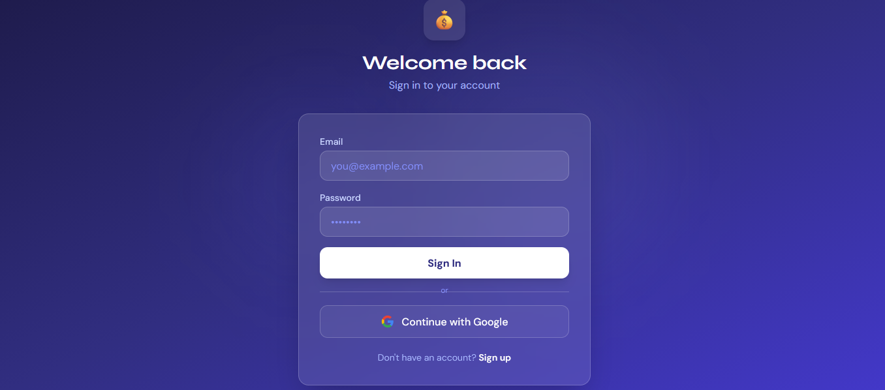

### Dashboard
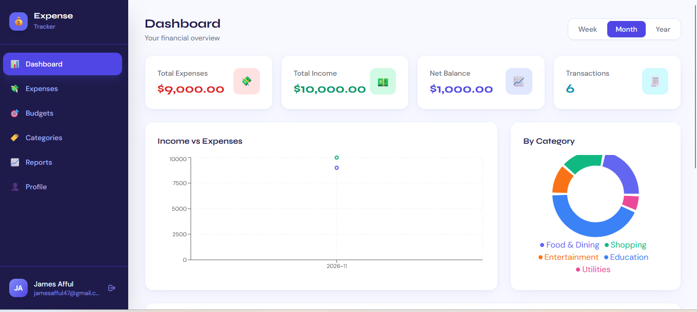

### Profile
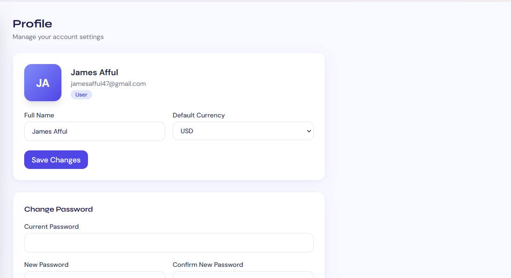

### Reports
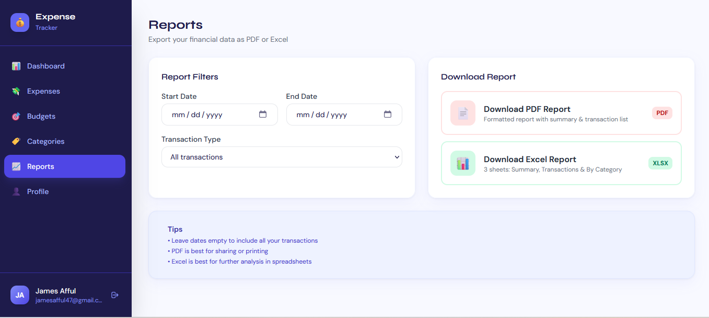

---

## AWS Infrastructure and Deployment

The following screenshots document the AWS infrastructure used during the application's deployment. **This AWS environment has since been decommissioned.**

<details>
<summary>View AWS infrastructure screenshots</summary>

### Virtual Private Cloud (VPC)
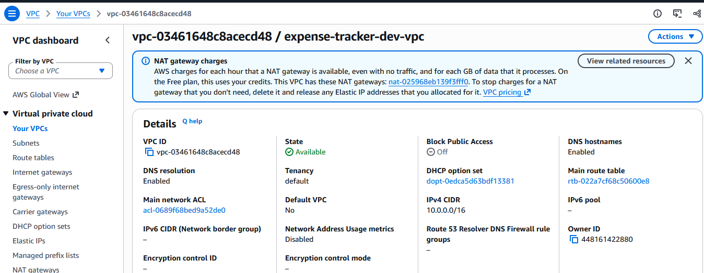

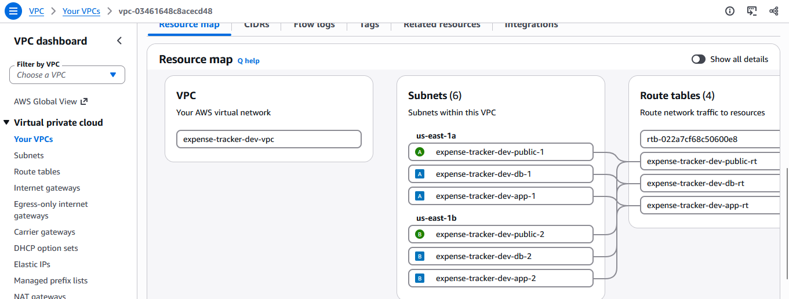

### Elastic Container Service (ECS)
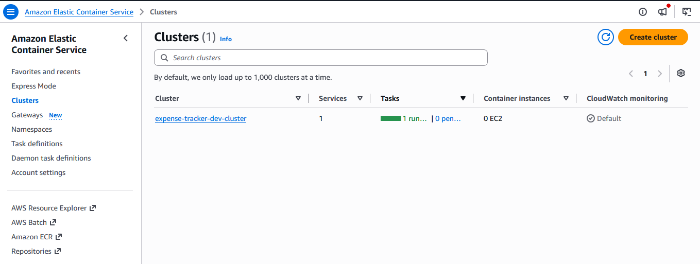

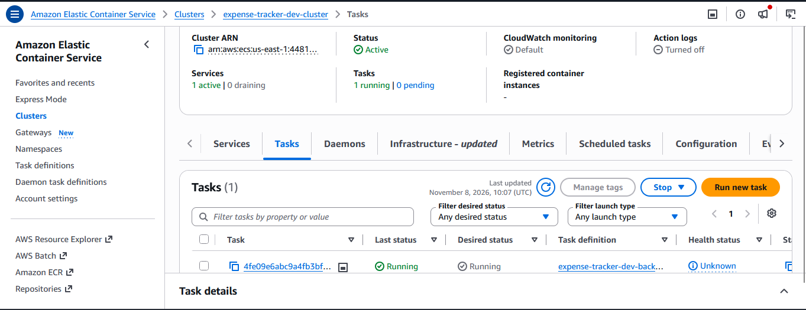

### Relational Database Service (RDS)
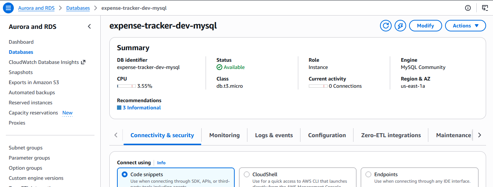

### CloudFront
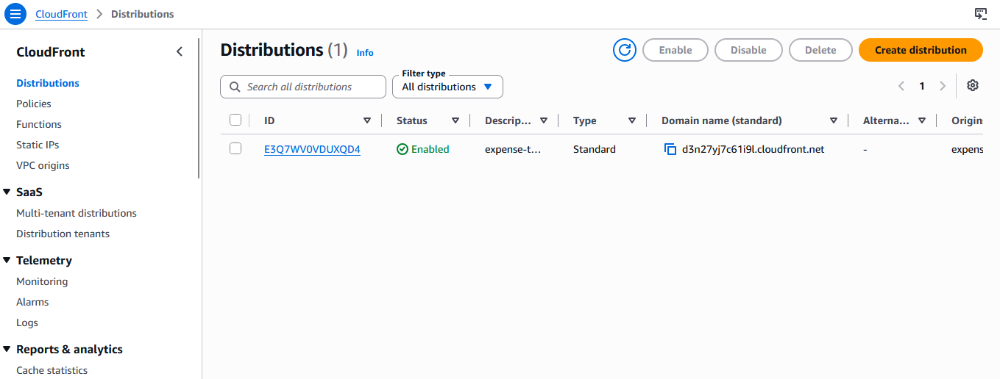

### CloudWatch
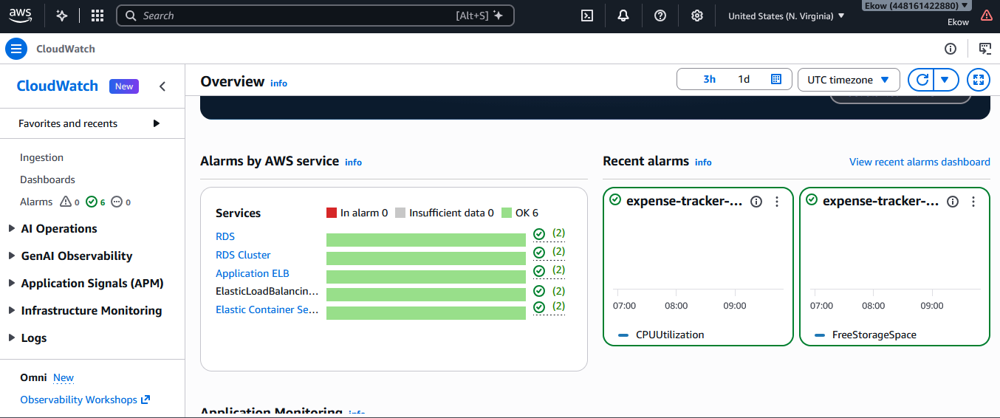

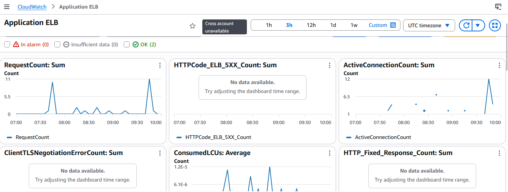

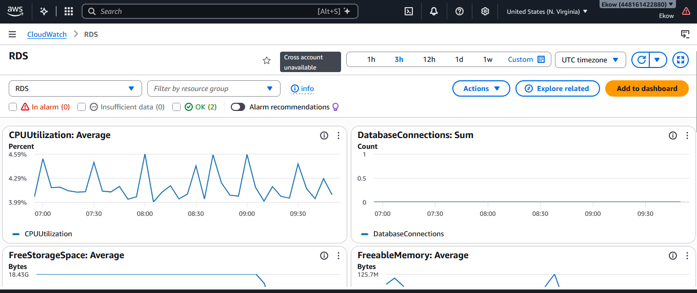

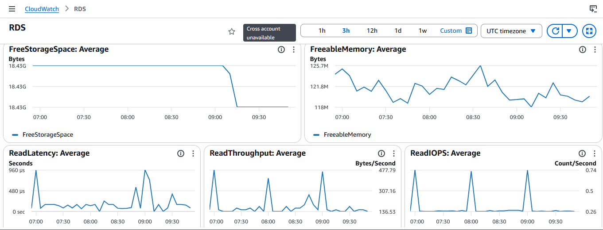

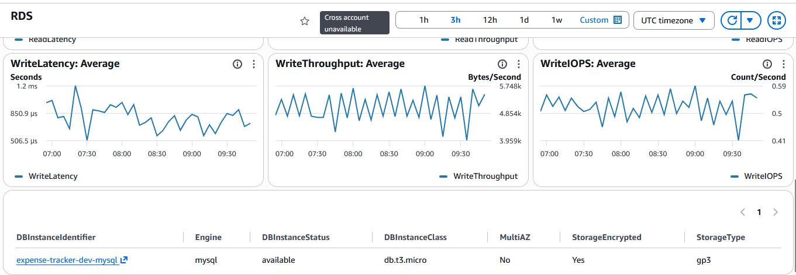

### Secrets Manager
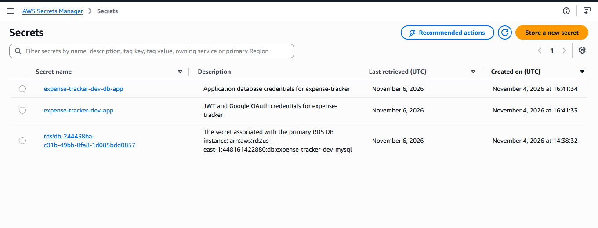

</details>

---

## CI/CD Pipeline

### Deployment Workflow
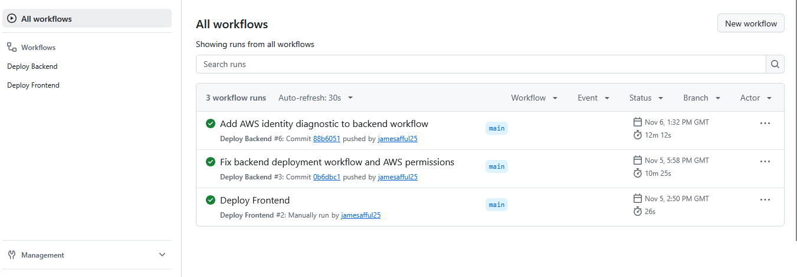

### Backend Deployment
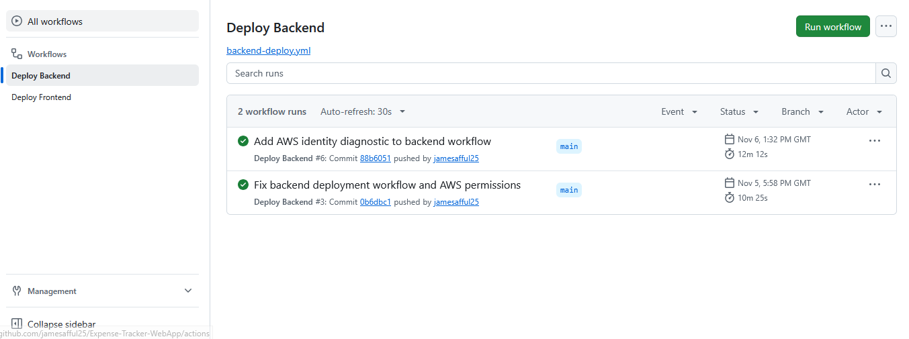

### Frontend Deployment
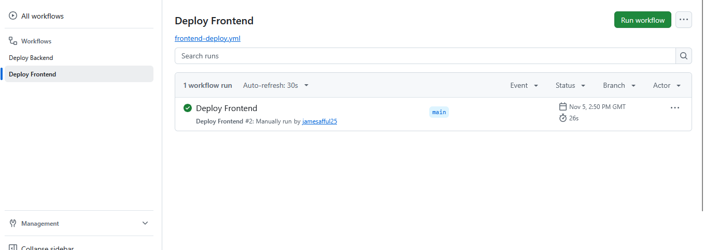
---

## Getting Started

### Prerequisites
- Node.js 18+
- MySQL 8+

### Backend Setup

```bash
cd expense_tracker_app/backend
npm install
cp .env.example .env
# Edit .env with your database credentials and secrets
npm run dev
```

### Frontend Setup

```bash
cd expense_tracker_app/frontend
npm install
npm run dev
```

---

##  Environment Variables (backend/.env)

```env
PORT=5000
DB_HOST=localhost
DB_PORT=3306
DB_NAME=expense_tracker
DB_USER=root
DB_PASSWORD=yourpassword
JWT_SECRET=your_very_secret_key
JWT_EXPIRES_IN=7d
GOOGLE_CLIENT_ID=your_google_client_id
GOOGLE_CLIENT_SECRET=your_google_secret
GOOGLE_CALLBACK_URL=http://localhost:5000/api/auth/google/callback
FRONTEND_URL=http://localhost:5173
```

---

##  API Endpoints

### Auth
| Method | Endpoint | Description |
|--------|----------|-------------|
| POST | `/api/auth/register` | Register |
| POST | `/api/auth/login` | Login |
| GET | `/api/auth/me` | Current user |
| GET | `/api/auth/google` | Google OAuth start |
| GET | `/api/auth/google/callback` | Google OAuth callback |

### Expenses
| Method | Endpoint | Description |
|--------|----------|-------------|
| GET | `/api/expenses` | List (paginated, filterable) |
| GET | `/api/expenses/:id` | Get one |
| POST | `/api/expenses` | Create (supports file upload) |
| PUT | `/api/expenses/:id` | Update |
| DELETE | `/api/expenses/:id` | Delete |
| GET | `/api/expenses/summary` | Analytics summary |
| GET | `/api/expenses/export?format=pdf\|excel` | Export report |

### Budgets, Categories, Users
- Standard CRUD endpoints on `/api/budgets`, `/api/categories`, `/api/users`
---
## Author

**James Afful**

**Full-Stack Developer | DevOps & Cloud Engineer | AI Automation Engineer | Data Scientist & Analytics Professional | Economist &Financial Analyst**

I am a multidisciplinary technology and finance professional with experience building full-stack web applications, designing cloud infrastructure, automating business processes, developing data-driven solutions and applying economic and financial analytics to real-world problems.

I designed and developed the Expense Tracker application, including its React frontend, Node.js/Express backend, database architecture, authentication system, reporting functionality and AWS deployment infrastructure.

### Core Technical Expertise

- **Frontend Development:** React.js, Vite, JavaScript, Tailwind CSS, HTML5, CSS3, Recharts
- **Backend Development:** Node.js, Express.js, Python, REST APIs, Sequelize
- **Cloud Engineering:** AWS, Azure, Amazon ECS, ECR, RDS, S3, CloudFront, IAM
- **DevOps & Infrastructure:** Terraform, Docker, Kubernetes, GitHub Actions, CI/CD, Infrastructure as Code
- **AI Automation Engineering:** Python-based AI automation, OpenAI API integration, workflow automation, n8n
- **Data Science & Analytics:** Python, SQL, Power BI, Predictive Analytics, Statistical Modelling, Data Visualization
- **Database Technologies:** MySQL, SQL
- **Economics & Finance:** Economic Research, Financial Modelling, Investment Analysis, Credit Risk Modelling, Corporate Finance

### Professional Links

- **GitHub:** https://github.com/jamesafful25
- **Portfolio:** https://jamesafful25.github.io/james-afful-portfolio/
- **Email:** james.afful47@gmail.com

---

*Designed, developed, and deployed by James Afful.*
